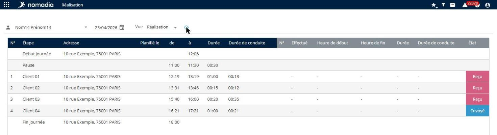

# Réalisation

Le module Réalisation affiche, pour un intervenant et une date, les étapes prévues de sa journée et leur réalisation.

## Accéder au module

**Navigation :** `Lanceur d'applications > Réalisation`

## Utiliser la fonctionnalité

1. Sélectionnez l'intervenant dans la liste, en haut à gauche.
2. Sélectionnez la date avec le calendrier.
3. Vérifiez que la **Vue** est **Réalisation**.

## Lire le tableau

Le tableau comporte deux parties.

* La partie de gauche décrit le prévu : **N°**, **Étape**, **Adresse**, **Planifié le**, **de**, **à**, **Durée**, **Durée de conduite**.
* La partie de droite décrit le réalisé : **N°**, **Effectué**, **Heure de début**, **Heure de fin**, **Durée**, **Durée de conduite**, **État**.

Les étapes comprennent le **Début journée**, la **Pause**, les rendez-vous numérotés et la **Fin journée**. La colonne **État** affiche une étiquette de couleur, par exemple **Reçu** ou **Envoyé**.

## Points d'attention

* L'icône située à droite de la liste **Vue** permet d'actualiser l'affichage.
