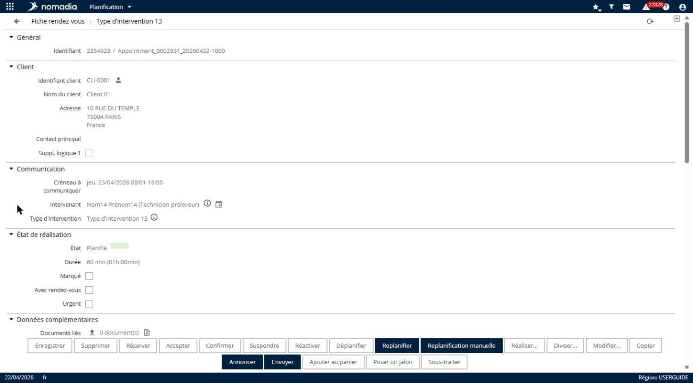

# Consulter la fiche d'un rendez-vous

La fiche d'un rendez-vous rassemble ses informations et les actions disponibles selon son état.

## Accéder à la fonctionnalité

Vous pouvez ouvrir la fiche d'un rendez-vous :

* depuis le résultat d'une recherche, avec **•••** au début de la ligne ;
* depuis le planning, avec l'icône **Ouvrir la fiche de l'intervention** ;
* depuis la liste des rendez-vous d'un client.

## Lire la fiche

Le titre **Fiche rendez-vous** est suivi du type d'intervention. Les informations sont réparties en sections repliables :

| Section                     | Contenu                                                                                                                                                                            |
| --------------------------- | ---------------------------------------------------------------------------------------------------------------------------------------------------------------------------------- |
| **Général**                 | Identifiant, Description                                                                                                                                                           |
| **Client**                  | Identifiant client, Nom du client, Adresse, Contact principal                                                                                                                      |
| **Communication**           | Créneau à communiquer, Intervenant, Type d'intervention                                                                                                                            |
| **État de réalisation**     | État, Durée, Marqué, Avec rendez-vous, Urgent. Pour un rendez-vous réalisé : dates de début et de fin effectives, durée effective, Réalisé par, Avancement, Rapport d'intervention |
| **Données complémentaires** | Documents liés, quantités et champs divers                                                                                                                                         |
| **Commentaires**            | Commentaires de la feuille de route, Commentaires internes                                                                                                                         |
| **Messages**                | Messages liés au rendez-vous                                                                                                                                                       |
| **Historique**              | Historique du rendez-vous                                                                                                                                                          |

## Utiliser les actions d'un rendez-vous planifié

Les boutons suivants sont proposés en bas de la fiche d'un rendez-vous planifié. Leur description reprend les info-bulles de l'application.

| Bouton                                        | Action                                                                                                    |
| --------------------------------------------- | --------------------------------------------------------------------------------------------------------- |
| **Enregistrer**                               | Enregistrer les commentaires du rendez-vous                                                               |
| **Supprimer**                                 | Supprimer                                                                                                 |
| **Réserver**, **Accepter**, **Confirmer**     | Changer l'état du rendez-vous                                                                             |
| **Suspendre**, **Réactiver**, **Déplanifier** | Sortir le rendez-vous du planning ou le remettre à planifier                                              |
| **Replanifier**                               | Replanifier le rendez-vous en lançant une optimisation temps réel ou en fixant une date et un intervenant |
| **Replanification manuelle**                  | Replanifier le rendez-vous manuellement                                                                   |
| **Réaliser...**                               | Réaliser le rendez-vous                                                                                   |
| **Diviser...**                                | Diviser le rendez-vous                                                                                    |
| **Modifier...**                               | Modifier les données du rendez-vous : le client, l'heure, la durée, l'adresse…                            |
| **Copier**                                    | Copier le rendez-vous                                                                                     |
| **Annoncer**                                  | Envoyer une annonce aux intervenants ou clients du rendez-vous concerné                                   |
| **Envoyer**                                   | Envoyer une notification aux intervenants affectés au rendez-vous                                         |
| **Ajouter au panier**                         | Ajouter au panier de rendez-vous                                                                          |
| **Poser un jalon**                            | Poser un jalon pour ce rendez-vous                                                                        |
| **Sous-traiter**                              | Envoyer le rendez-vous au sous-traitant                                                                   |

Pour le détail des changements d'état, consultez [Comprendre les états des rendez-vous](../introduction/statuts-rendez-vous.md).

## Utiliser les actions d'un rendez-vous confirmé

La fiche d'un rendez-vous confirmé propose notamment **Déconfirmer**, qui repasse le rendez-vous à l'état **Planifié**. Les boutons **Réserver**, **Accepter** et **Confirmer** ne sont plus proposés.

## Supprimer un rendez-vous

1. Sélectionnez **Supprimer**.
2. Si la fenêtre le propose, indiquez si la suppression est demandée par le client ou par l'entreprise, puis choisissez ou saisissez un motif.
3. Validez.

Le rendez-vous est annulé : il passe à l'état **Abandonné** s'il n'était pas planifié, **Déprogrammé** s'il l'était.

## Points d'attention

* Les boutons affichés varient selon l'état du rendez-vous. Par exemple, la fiche d'un rendez-vous réalisé propose **Enregistrer**, **Déplanifier**, **Annuler la réalisation** et **Copier**.
* Selon le paramétrage, une fenêtre peut vous demander un motif avant une replanification ou une suspension.
