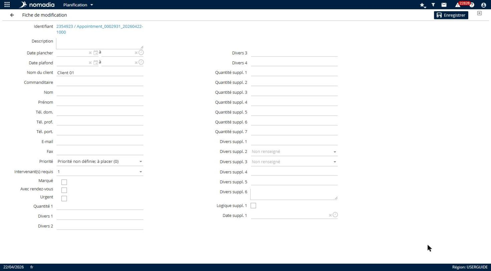

# Modifier un rendez-vous

La fiche de modification permet de mettre à jour les données d'un rendez-vous : description, dates plancher et plafond, coordonnées du contact, priorité et champs complémentaires.

## Accéder à la fonctionnalité

**Navigation :** `Fiche rendez-vous > Modifier...`

## Utiliser la fonctionnalité

1. Ouvrez la fiche du rendez-vous. Pour en savoir plus, consultez [Consulter la fiche d'un rendez-vous](fiche-rendez-vous.md).
2. Sélectionnez **Modifier...**.
3. Dans la **Fiche de modification**, modifiez les champs souhaités.
4. Sélectionnez **Enregistrer**.

La fiche de modification contient notamment les champs **Description**, **Date plancher**, **Date plafond**, **Nom du client**, **Commanditaire**, **Nom**, **Prénom**, **Tél. dom.**, **Tél. prof.**, **Tél. port.**, **E-mail**, **Fax**, **Priorité**, **Intervenant(s) requis**, **Marqué**, **Avec rendez-vous**, **Urgent**, ainsi que les quantités et champs divers.

## Résultat

La fiche du rendez-vous s'affiche de nouveau avec les données mises à jour.
