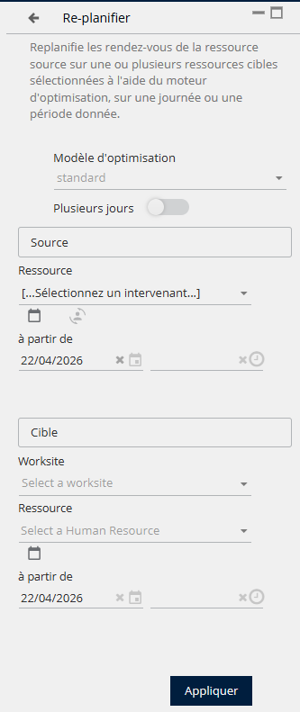

# Traiter plusieurs rendez-vous en une fois

Plusieurs fonctions traitent en une seule opération l'ensemble des rendez-vous d'un intervenant ou d'une sélection : utile en cas d'absence imprévue, de surcharge ou de réorganisation.

| Fonction                | Effet                                                                                                                                                      |
| ----------------------- | ---------------------------------------------------------------------------------------------------------------------------------------------------------- |
| **Echanger**            | Échange les tournées de deux intervenants pour une même journée. Les rendez-vous sont permutés, sans réoptimisation.                                       |
| **Re-planifier**        | Replanifie les rendez-vous d'un intervenant source sur un ou plusieurs intervenants cibles, avec le moteur d'optimisation, sur une journée ou une période. |
| Planifier une sélection | Soumet au moteur d'optimisation les rendez-vous de la liste des rendez-vous sélectionnés.                                                                  |

## Accéder à la fonctionnalité

**Navigation :** `Planification > Rendez-vous > Echanger` ou `Planification > Rendez-vous > Re-planifier`

## Échanger les tournées de deux intervenants

1. Ouvrez `Planification > Rendez-vous > Echanger`.
2. Dans **Source**, choisissez la **Ressource** et la date.
3. Dans **Cible**, choisissez la ressource et la date.
4. Sélectionnez **Appliquer**.

## Replanifier les rendez-vous d'un intervenant

1. Ouvrez `Planification > Rendez-vous > Re-planifier`.
2. Choisissez le **Modèle d'optimisation**.
3. Activez **Plusieurs jours** pour traiter une période plutôt qu'une journée.
4. Dans **Source**, choisissez la **Ressource** et la date (**à partir de**).
5. Dans **Cible**, choisissez le site de travail et la ou les ressources cibles, puis la date.
6. Sélectionnez **Appliquer**.


Plus il y a de ressources cibles et plus la période est large, plus le moteur a de chances de replanifier tous les rendez-vous. La source et la cible peuvent être le même intervenant : son planning est alors réoptimisé sur la période.


## Planifier les rendez-vous sélectionnés

1. Ajoutez les rendez-vous à la liste de sélection depuis une liste de résultats, la carte ou le planning.
2. Ouvrez `Planification > Rendez-vous > Lister les rendez-vous sélectionnés`.
3. Lancez l'action **Planifier plusieurs rendez-vous**.
4. Choisissez la période (**Début**, **Fin**) et les intervenants, par **Équipe**, **Site de travail** ou **Intervenant**.
5. Validez.

La liste des rendez-vous sélectionnés propose aussi de réaffecter des ressources aux rendez-vous sélectionnés (ressource **Requis**, **Souhaité** ou **Indésirable**). Cette action ne s'applique qu'aux rendez-vous à l'état **Demandé**.

## Points d'attention


La planification d'une sélection ne transfère pas les rendez-vous déjà planifiés : elle les soumet de nouveau au moteur. Un rendez-vous **Demandé** est recherché sur toute la période saisie, un rendez-vous **Planifié** uniquement dans sa période de réalisation possible. Certains rendez-vous peuvent donc rester sur leur intervenant d'origine.

