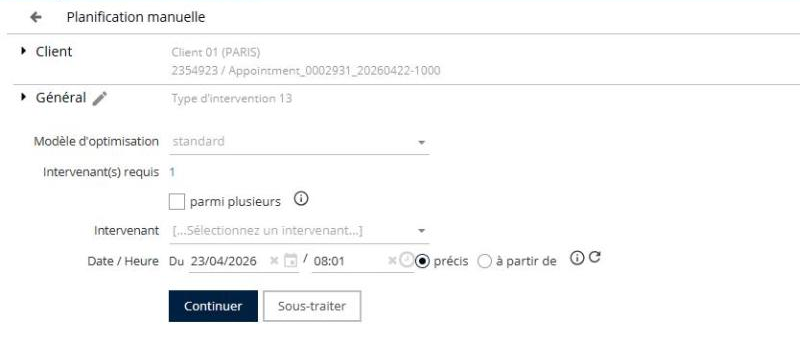
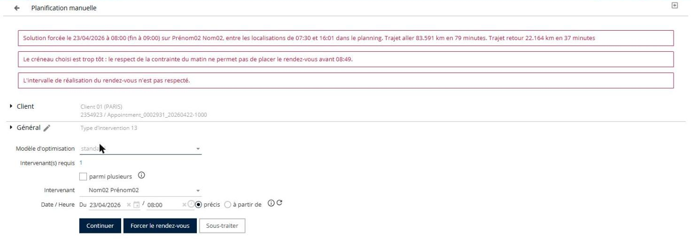

# Planifier un rendez-vous manuellement

La planification manuelle permet de fixer vous-même l'intervenant, la date et l'heure d'un rendez-vous. L'application contrôle ensuite le respect des contraintes.

## Accéder à la fonctionnalité

La planification manuelle est accessible :

* lors de la prise de rendez-vous, avec le bouton **Planification manuelle** ;
* depuis la fiche d'un rendez-vous planifié, avec le bouton **Replanification manuelle**.

## Utiliser la fonctionnalité

L'écran **Planification manuelle** s'affiche.

1. Vérifiez le **Modèle d'optimisation** et le nombre d'**Intervenant(s) requis**.
2. Dans **Intervenant**, sélectionnez l'intervenant. La liste est regroupée par type d'intervenant.
3. Dans **Date / Heure**, indiquez la date et l'heure.
4. Choisissez **précis** ou **à partir de**.
5. Sélectionnez **Continuer**.

## Résultat

L'application vérifie le créneau demandé. Si des contraintes ne sont pas respectées, des messages s'affichent en haut de l'écran, par exemple :

* une proposition de solution indiquant la date, l'heure, l'intervenant et les trajets aller et retour ;
* **Le créneau choisi est trop tôt** avec l'heure minimale possible ;
* **L'intervalle de réalisation du rendez-vous n'est pas respecté.**

Le bouton **Forcer le rendez-vous** apparaît alors à côté de **Continuer**.

## Points d'attention

* Lisez les messages de contrôle avant d'utiliser **Forcer le rendez-vous**.
* La case **parmi plusieurs** et le bouton **Sous-traiter** sont également disponibles sur cet écran.
* La flèche en haut à gauche permet de revenir à l'écran précédent sans planifier.
