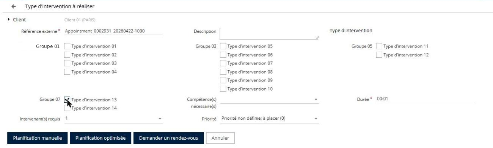
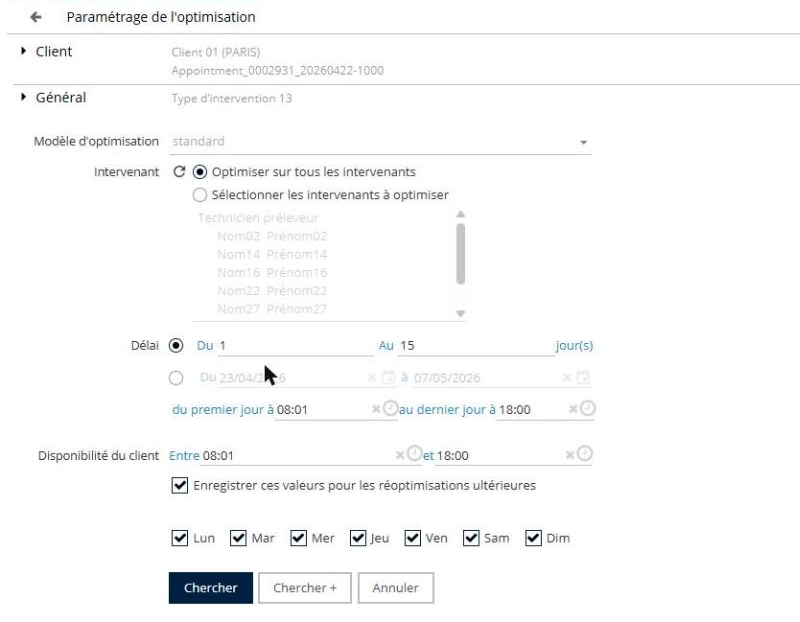
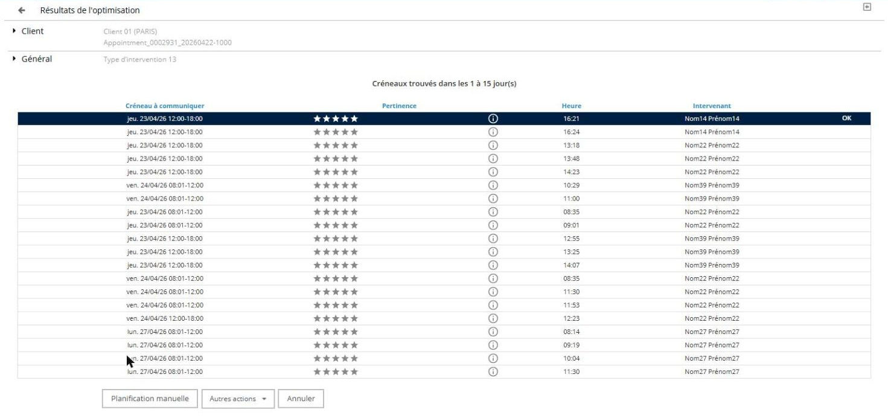
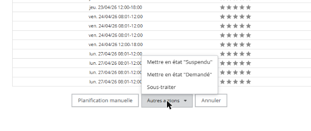
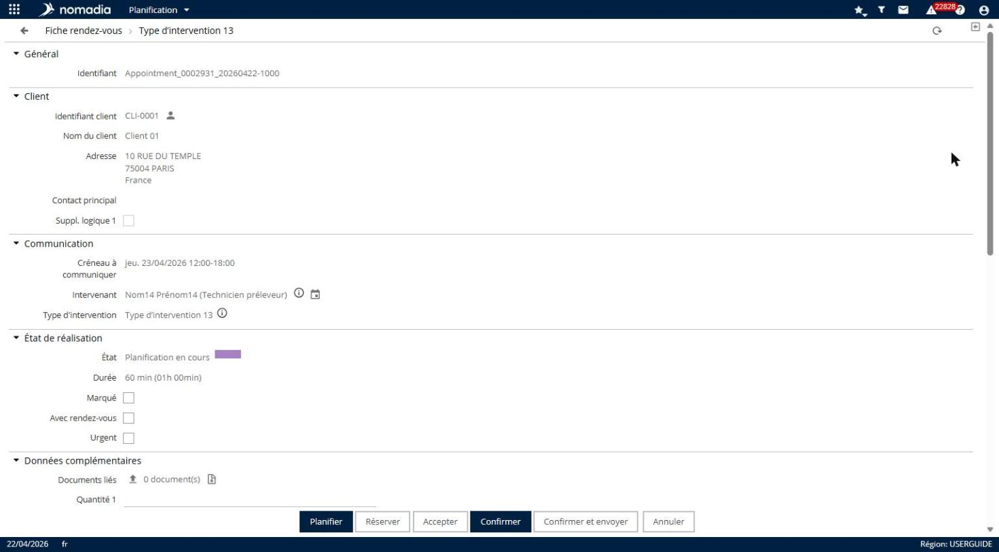
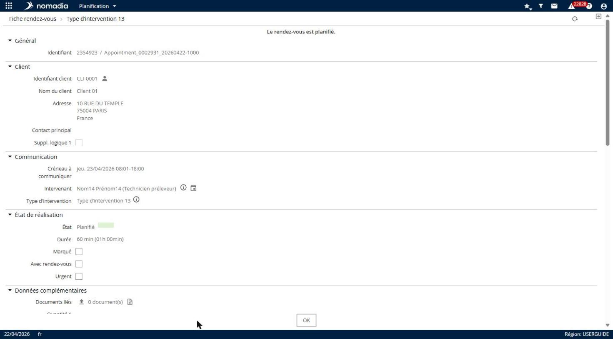

# Prendre un rendez-vous

Cette procédure permet de créer un rendez-vous pour un client, d'obtenir des créneaux proposés par l'optimisation, puis de planifier le créneau retenu.

## Avant de commencer

Le client doit exister dans l'application. Pour en savoir plus, consultez [Créer un client](../clients/creer-client.md).

## Accéder à la fonctionnalité

**Navigation :** `Planification > fiche du client > Créer un rendez-vous`

Ouvrez la fiche du client, par exemple depuis [Rechercher un client](../clients/rechercher-client.md), puis sélectionnez **Créer un rendez-vous**.

## Décrire l'intervention

L'écran **Type d'intervention à réaliser** s'affiche.

1. Vérifiez la **Référence externe**. Elle est proposée automatiquement.
2. Saisissez une **Description** si nécessaire.
3. Cochez le ou les types d'intervention à réaliser. Ils sont regroupés par groupe d'interventions.
4. Vérifiez la **Durée**. Elle est préremplie selon le type d'intervention choisi.
5. Complétez si besoin les champs **Compétence(s) nécessaire(s)**, **Intervenant(s) requis** et **Priorité**.

6. Choisissez le mode de planification :

| Bouton                      | Usage                                                                       |
| --------------------------- | --------------------------------------------------------------------------- |
| **Planification manuelle**  | Fixer manuellement l'intervenant, la date et l'heure du rendez-vous         |
| **Planification optimisée** | Optimiser le rendez-vous en temps réel                                      |
| **Demander un rendez-vous** | Entrer la demande de rendez-vous. Le rendez-vous sera optimisé par la suite |

La suite de cette page décrit la **Planification optimisée**. Pour la planification manuelle, consultez [Planifier un rendez-vous manuellement](planification-manuelle.md).

## Paramétrer l'optimisation

L'écran **Paramétrage de l'optimisation** s'affiche.

1. Vérifiez le **Modèle d'optimisation**.
2. Dans **Intervenant**, choisissez **Optimiser sur tous les intervenants** ou **Sélectionner les intervenants à optimiser**, puis sélectionnez les intervenants dans la liste.
3. Dans **Délai**, indiquez la période de recherche :
   * en nombre de jours, avec **Du** et **Au** ;
   * ou entre deux dates.
4. Ajustez les heures **du premier jour à** et **au dernier jour à**.
5. Ajustez la **Disponibilité du client** (**Entre** et **et**).
6. Cochez ou décochez les jours de la semaine (**Lun** à **Dim**).
7. Sélectionnez **Chercher**.

La case **Enregistrer ces valeurs pour les réoptimisations ultérieures** est cochée par défaut.

## Choisir un créneau

L'écran **Résultats de l'optimisation** liste les **Créneaux trouvés**. Pour chaque créneau, il indique le **Créneau à communiquer**, la **Pertinence** (étoiles), l'**Heure** et l'**Intervenant**.

1. Sélectionnez la ligne du créneau souhaité.
2. Sélectionnez **OK** sur cette ligne.

Si aucun créneau ne convient, le bouton **Autres actions** propose **Mettre en état "Suspendu"**, **Mettre en état "Demandé"** et **Sous-traiter**. Le bouton **Planification manuelle** est également disponible.

## Valider le rendez-vous

La fiche du rendez-vous s'affiche avec l'état **Planification en cours**. Les boutons suivants permettent de valider le créneau. Le bouton **Annuler** est également disponible.

| Bouton                   | Effet                                                                       |
| ------------------------ | --------------------------------------------------------------------------- |
| **Planifier**            | Planifier le rendez-vous comme prévu                                        |
| **Réserver**             | Réserver le rendez-vous : l'heure du rendez-vous est définie                |
| **Accepter**             | Accepter le rendez-vous : le rendez-vous ne doit plus changer d'affectation |
| **Confirmer**            | Confirmer le rendez-vous                                                    |
| **Confirmer et envoyer** | Confirmer et envoyer le rendez-vous                                         |

1. Sélectionnez le bouton correspondant à votre besoin, par exemple **Planifier**.
2. Sélectionnez **OK** dans le message de confirmation.

## Résultat

Le message **Le rendez-vous est planifié.** s'affiche et l'état du rendez-vous devient **Planifié**. Le rendez-vous apparaît dans le planning de l'intervenant, et la **Prochaine date de visite** de la fiche client est mise à jour.

