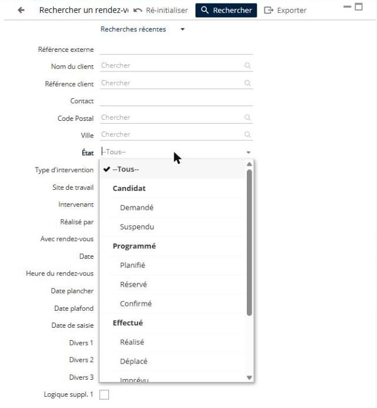
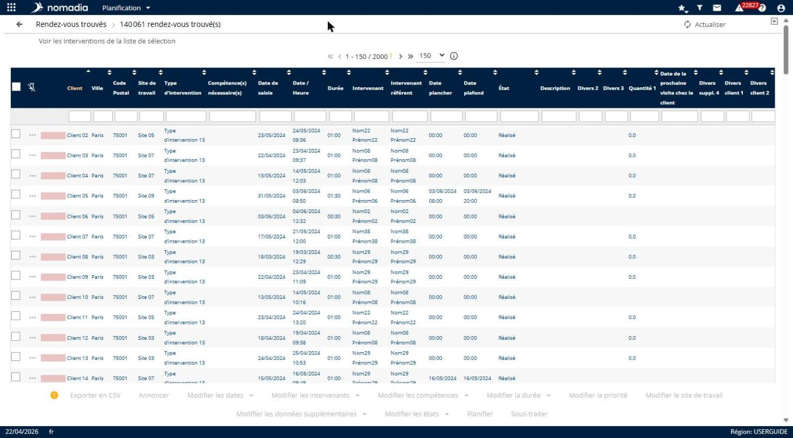

# Rechercher des rendez-vous

La recherche de rendez-vous permet de retrouver des rendez-vous selon de nombreux critères, puis d'ouvrir leur fiche ou d'appliquer une action à plusieurs rendez-vous.

## Accéder à la fonctionnalité

**Navigation :** `Planification > menu Rendez-vous > Rechercher des rendez-vous`

Vous pouvez aussi sélectionner le raccourci **RECHERCHER DES RENDEZ-VOUS** sur l'écran d'accueil du module.

## Renseigner les critères

Le panneau **Rechercher un rendez-vous** propose les critères suivants :

* **Référence externe**, **Nom du client**, **Référence client**, **Contact** ;
* **Code Postal**, **Ville** ;
* **État**, **Type d'intervention**, **Site de travail** ;
* **Intervenant**, **Réalisé par**, **Avec rendez-vous** ;
* **Date** (**Du** / **Au**), **Heure du rendez-vous** (**Début** / **Fin**) ;
* **Date plancher**, **Date plafond**, **Date de saisie** ;
* **Divers 1** à **Divers 3**, **Logique suppl. 1**.

1. Renseignez un ou plusieurs critères.
2. Sélectionnez **Rechercher**.

Le bouton **Ré-initialiser** et la liste **Recherches récentes** sont également disponibles en haut du panneau.


Une recherche sans critère peut porter sur un très grand nombre de rendez-vous et prendre du temps. Renseignez au moins une date ou un état pour limiter le résultat.


## Exploiter les résultats

La page **Rendez-vous trouvés** indique le nombre de rendez-vous trouvés et les affiche par pages. Le nombre de lignes par page se règle au-dessus du tableau.

* Triez une colonne avec les flèches de son en-tête.
* Filtrez une colonne avec le champ situé sous l'en-tête.
* Sélectionnez **•••** au début d'une ligne pour ouvrir la fiche du rendez-vous.
* Le bouton **Actualiser** est disponible en haut de la liste.

## Agir sur plusieurs rendez-vous

1. Cochez les rendez-vous concernés.
2. Sélectionnez l'action souhaitée en bas de la liste :
   * **Exporter en CSV** ;
   * **Annoncer** ;
   * **Modifier les dates**, **Modifier les intervenants**, **Modifier les compétences**, **Modifier la durée**, **Modifier la priorité**, **Modifier le site de travail**, **Modifier les données supplémentaires**, **Modifier les états** ;
   * **Planifier** ;
   * **Sous-traiter**.

## Utiliser les recherches prêtes à l'emploi

La rubrique `Planification > Rendez-vous > Mes recherches` du menu regroupe, selon vos droits :

* les listes de rendez-vous par état : **Rendez-vous demandés**, **Chercher les rendez-vous planifiés**, **Rendez-vous acceptés**, **Rendez-vous réservés**, **Rendez-vous confirmés**, **Rendez-vous déplanifiés**, **Rendez-vous sous-traités** ;
* les listes **Liste des rendez-vous de MySearch 1** à **15**, configurées par l'administrateur ;
* vos vues personnelles, par exemple **Mes RDV planifiés du jour**.

Pour créer ou modifier ces vues, consultez [Gérer les vues de recherche](../planification/gerer-vues/).

## Points d'attention

* L'icône d'agrandissement du panneau permet d'afficher toutes les colonnes du résultat.
* Le lien **Voir les interventions de la liste de sélection** est affiché au-dessus du résultat.
