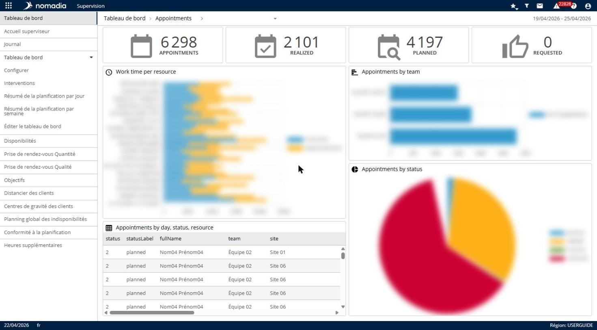

# Supervision

Le module Supervision rassemble les outils de suivi de l'activité : tableaux de bord, suivi des rendez-vous passés et à venir, journal des actions et analyses.

## Accéder au module

**Navigation :** `Lanceur d'applications > Supervision`

Le menu de gauche propose les entrées suivantes :

| Entrée                       | Contenu                                                                                                                                                                                                                                                                         |
| ---------------------------- | ------------------------------------------------------------------------------------------------------------------------------------------------------------------------------------------------------------------------------------------------------------------------------- |
| **Tableau de bord**          | Tableau de bord graphique de l'activité                                                                                                                                                                                                                                         |
| **Accueil superviseur**      | Suivi des rendez-vous passés et à venir                                                                                                                                                                                                                                         |
| **Journal**                  | Historique des actions sur les rendez-vous et les indisponibilités                                                                                                                                                                                                              |
| **Tableau de bord** (groupe) | **Configurer**, **Interventions**, **Résumé de la planification par jour**, **Résumé de la planification par semaine**, **Éditer le tableau de bord**                                                                                                                           |
| Analyses                     | **Disponibilités**, **Prise de rendez-vous Quantité**, **Prise de rendez-vous Qualité**, **Objectifs**, **Distancier des clients**, **Centres de gravité des clients**, **Planning global des indisponibilités**, **Conformité à la planification**, **Heures supplémentaires** |

## Tableau de bord

À l'ouverture du module, le tableau de bord affiche des indicateurs (nombre total de rendez-vous, rendez-vous réalisés, planifiés et demandés), des graphiques et un tableau détaillé. La période affichée est indiquée en haut à droite.


Certains libellés de ce tableau de bord s'affichent en anglais.


## Dans cette section

* [Suivre les rendez-vous passés et à venir](accueil-superviseur.md)
* [Consulter le journal](journal.md)
* [Configurer et consulter les tableaux de bord](tableaux-de-bord.md)
* [Utiliser les analyses de la Supervision](analyses.md)
