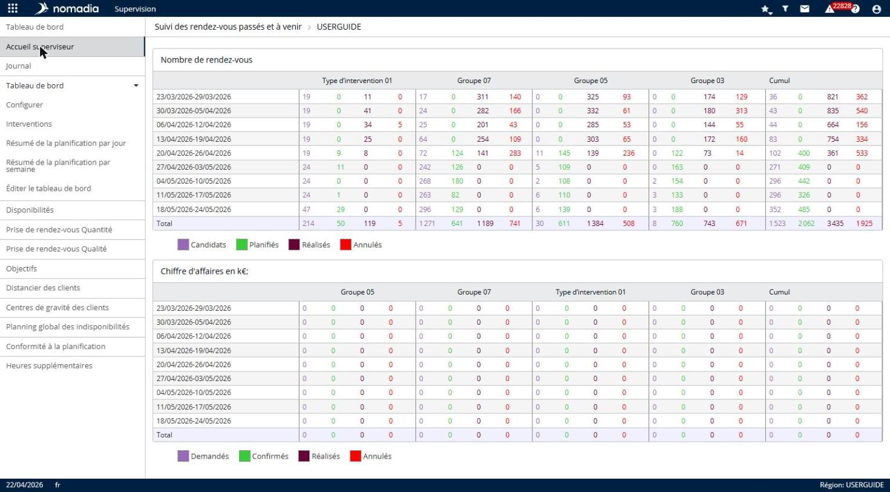

# Suivre les rendez-vous passés et à venir

La page **Accueil superviseur** présente, semaine par semaine, le nombre de rendez-vous et le chiffre d'affaires associé.

## Accéder à la fonctionnalité

**Navigation :** `Supervision > Accueil superviseur`

## Lire la page

La page **Suivi des rendez-vous passés et à venir** est suivie du nom de la région. Elle contient deux tableaux :

* **Nombre de rendez-vous** : pour chaque semaine, le nombre de rendez-vous **Candidats**, **Planifiés**, **Réalisés** et **Annulés**, par groupe ou type d'intervention ;
* **Chiffre d'affaires en k€** : pour chaque semaine, les montants **Demandés**, **Confirmés**, **Réalisés** et **Annulés**.

La colonne **Cumul** totalise les valeurs de la ligne et la ligne **Total** totalise les semaines.

Chaque couleur de chiffre correspond à une catégorie, rappelée dans la légende sous le tableau.
