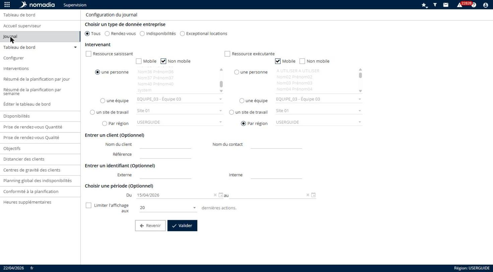
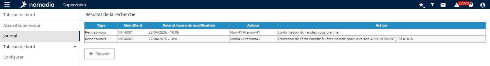

# Consulter le journal

Le journal liste les actions réalisées sur les données : création, changement d'état, confirmation, etc. Il permet de savoir qui a fait quoi et quand.

## Accéder à la fonctionnalité

**Navigation :** `Supervision > Journal`

## Utiliser la fonctionnalité

La page **Configuration du journal** s'affiche.

1. Dans **Choisir un type de donnée entreprise**, sélectionnez **Tous**, **Rendez-vous**, **Indisponibilités** ou **Exceptional locations**.
2. Dans **Intervenant**, choisissez si besoin la **Ressource saisissant** ou la **Ressource exécutante**, puis le périmètre : **une personne**, **une équipe**, **un site de travail** ou **Par région**.
3. Renseignez si besoin les champs facultatifs :
   * **Entrer un client** : **Nom du client**, **Nom du contact**, **Référence** ;
   * **Entrer un identifiant** : **Externe**, **Interne** ;
   * **Choisir une période** : **Du** et **au**.
4. Pour limiter le résultat, cochez **Limiter l'affichage aux** et choisissez le nombre de **dernières actions**.
5. Sélectionnez **Valider**.

## Résultat

La page **Résultat de la recherche** affiche, pour chaque action, le **Type** de donnée, l'**Identifiant**, la **Date et heure de modification**, l'**Auteur** et l'**Action** réalisée.

Le bouton **Revenir** est disponible sous le tableau.
