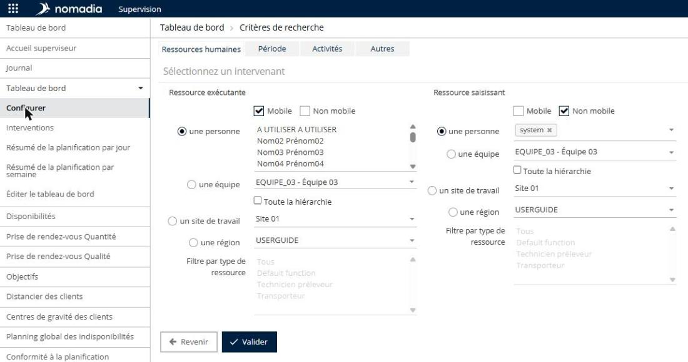
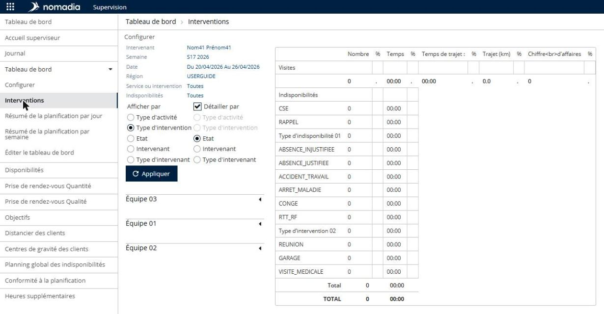

# Configurer et consulter les tableaux de bord

Les tableaux de bord de la supervision présentent l'activité selon des critères de ressources, de période et d'activité.

## Configurer les critères

**Navigation :** `Supervision > Tableau de bord > Configurer`

La page **Tableau de bord > Critères de recherche** comporte quatre onglets.

| Onglet                  | Critères                                                                                                                                                                            |
| ----------------------- | ----------------------------------------------------------------------------------------------------------------------------------------------------------------------------------- |
| **Ressources humaines** | **Ressource exécutante** et **Ressource saisissant** : une personne, une équipe (avec **Toute la hiérarchie**), un site de travail ou une région ; **Filtre par type de ressource** |
| **Période**             | **Semaine**, **Mois**, **Trimestre**, **Année** ou dates **Du** / **Au**                                                                                                            |
| **Activités**           | Type d'intervention (optionnel) : **Ignorer**, **Type d'activité** ou **Offre**, avec **Statut** ; indisponibilité (optionnel) : **Type**                                           |
| **Autres**              | Affichage des **Temps de trajet** et des **Temps vides**                                                                                                                            |

1. Renseignez les critères dans chaque onglet.
2. Sélectionnez **Valider**.


Les onglets **Activités** et **Autres** précisent que leur configuration n'est pas prise en compte dans les tableaux de résumé des plannings.


## Consulter le tableau Interventions

**Navigation :** `Supervision > Tableau de bord > Interventions`

La page rappelle la configuration en cours (intervenant, semaine, dates, région, services et indisponibilités) et affiche un tableau par équipe.

1. Dans **Afficher par**, choisissez le regroupement : **Type d'activité**, **Type d'intervention**, **Etat**, **Intervenant** ou **Type d'intervenant**.
2. Pour un second niveau, cochez **Détailler par** et choisissez le critère.
3. Sélectionnez **Appliquer**.

Le tableau affiche, pour les visites et pour chaque type d'indisponibilité, le **Nombre**, le **Temps**, le **Temps de trajet**, le **Trajet (km)** et le **Chiffre d'affaires**, avec leurs pourcentages.

## Autres tableaux et analyses

| Entrée                                                          | Éléments disponibles                                                                                                                                      |
| --------------------------------------------------------------- | --------------------------------------------------------------------------------------------------------------------------------------------------------- |
| **Résumé de la planification par jour** / **par semaine**       | Dates **Du** et **au**, options **Afficher les jours vides** et **Afficher les sommes / indices**, boutons **Rechercher**, **Export csv**, **Configurer** |
| **Disponibilités**                                              | Nombre de visites programmées, nombre d'heures programmées et temps travaillé par jour, par équipe                                                        |
| **Prise de rendez-vous Quantité** / **Qualité**                 | Rendez-vous pris, en nombre et en pourcentage, avec rappel de la configuration (**Saisi par**, intervenant, semaine, région)                              |
| **Objectifs**                                                   | Rappel de la configuration (**Intervenant**, **Semaine**, **Service ou intervention**)                                                                    |
| **Distancier des clients** / **Centres de gravité des clients** | **Mode**, **Intervenants requis**, **Intervenants de la région**, **Afficher les distances clients**, **Export csv**                                      |
| **Planning global des indisponibilités**                        | **Équipe**, **Du**, **Au**, **Export csv**                                                                                                                |
| **Conformité à la planification** / **Heures supplémentaires**  | **Du**, **au**, **Rechercher**, **Export csv**                                                                                                            |
| **Éditer le tableau de bord**                                   | Liste des tableaux de bord et bouton **Nouveau tableau de bord**                                                                                          |

## Consulter le résumé de la planification

Les pages **Résumé de la planification par jour** et **Résumé de la planification par semaine** présentent, pour chaque intervenant de la configuration, les indicateurs de ses tournées : visites, trajets, indisponibilités, congés, temps de travail et pauses.

1. Ouvrez **Résumé de la planification par jour** (ou **par semaine**).
2. Renseignez la période **Du** … **au**.
3. Cochez si besoin **Afficher les jours vides** pour lister aussi les jours sans activité.
4. Cochez si besoin **Afficher les sommes & indices** pour ajouter une ligne de totaux et des indices, par exemple les kilomètres parcourus par visite ou la part du temps de travail consacrée aux visites.
5. Sélectionnez **Rechercher**, puis **Export csv** pour exporter le tableau.

> **\[CAPTURE À PRENDRE]**
>
> * **Écran / Menu :** `Supervision > Tableau de bord > Résumé de la planification par jour`
> * **Contexte / Données à afficher :** résultat sur une semaine avec **Afficher les sommes & indices** coché, ligne de totaux visible (configuration préalable avec une équipe de test).
> * **Rappel :** anonymiser les noms des clients et des ressources, ainsi que le nom de l'organisation de l'environnement de test.

## Lire les tableaux Prise de rendez-vous

Ces tableaux nécessitent une configuration préalable : sans elle, un message d'erreur s'affiche. Pour en savoir plus, consultez la section [Configurer les critères](tableaux-de-bord.md#configurer-les-criteres).

* **Prise de rendez-vous Quantité** mesure le volume de rendez-vous pris par la ressource sélectionnée, comparé à celui du site de travail et de la région. Pour les rendez-vous placés par optimisation, il compare le coût réel des rendez-vous au meilleur coût proposé : une moyenne des coûts réels proche de la moyenne des coûts optimaux indique que les rendez-vous sont pris au meilleur coût.
* **Prise de rendez-vous Qualité** mesure le nombre de rendez-vous pris, annulés et modifiés, et les délais offerts au client, par exemple le délai moyen entre la prise de rendez-vous et la visite.

## Suivre les objectifs

Le tableau **Objectifs** compare l'activité de la période configurée aux objectifs définis dans l'administration. Pour en savoir plus, consultez [Gérer les objectifs, le suivi de l'activité et les typologies](../administration/objectifs-suivi-activite.md).

Si aucun objectif ne correspond à la configuration, le message « Aucun objectif trouvé » s'affiche.

Pour les analyses (distances, centres de gravité, conformité, heures supplémentaires), consultez [Utiliser les analyses de la Supervision](analyses.md).
