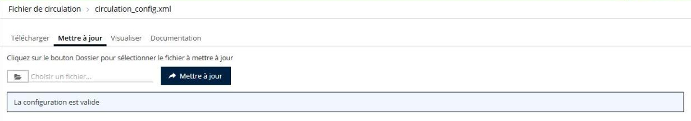

# Charger un fichier de circulation

## Chargement au démarrage du serveur

Au démarrage, Nomadia Field Service lit le fichier de circulation dans le répertoire de paramètres du serveur. Le nom du fichier est fixé par le paramètre serveur `circulation-config-file-name` (valeur par défaut : `circulation_config.xml`). Si ce paramètre n'est pas renseigné, aucune circulation n'est démarrée.

Le chargement suit les étapes ci-dessous. En cas d'erreur, la circulation reste arrêtée et les erreurs sont affichées dans le rapport de chargement.


Une circulation non démarrée n'exécute plus aucun échange : ni import, ni export, ni notification. Contrôlez le rapport de chargement après chaque redémarrage et chaque import.


Lorsque la circulation n'a pas démarré, un encadré **Fichier de circulation** reprenant les erreurs s'affiche sur la page d'accueil de l'administration (**À propos de Nomadia Field Service**).

## Importer un nouveau fichier de circulation

L'import remplace la configuration en cours par un nouveau fichier.

1. Préparez le fichier et vérifiez-le avec un éditeur XML capable de le valider contre le schéma `circulation-config.xsd` (voir [Règles générales](reference/)).
2. Ouvrez `Administration > Fichiers XML > Fichier de circulation`, onglet **Mettre à jour**.
3. Cliquez sur le bouton Dossier et sélectionnez le fichier.
4. Cliquez sur **Mettre à jour**.
5. Lisez le rapport de chargement affiché sous le formulaire.

### Résultat

* Le message « Mise à jour effectuée » s'affiche et le rapport indique que la configuration est valide.
* Le fichier importé remplace `circulation_config.xml` sur le serveur : il sera aussi utilisé au prochain redémarrage. Il n'est plus nécessaire de le copier manuellement sur le serveur.
* Une copie datée du fichier chargé est conservée à côté de celui-ci (historique des circulations chargées), sauf si son contenu est identique à la dernière copie.

### En cas d'erreur

* Le message « Erreur lors de l'import des fichiers ! » s'affiche avec le détail des erreurs.
* Le fichier est refusé : le fichier en place n'est pas modifié et la circulation précédente est redémarrée.


L'import est un remplacement complet, pas un ajout : tous les flux doivent figurer dans le fichier importé. Pendant l'import, la circulation en cours est arrêtée, quel que soit le résultat.


## Messages du rapport de chargement

| Message (extrait)                                                                                                                | Cause et action                                                                                                               |
| -------------------------------------------------------------------------------------------------------------------------------- | ----------------------------------------------------------------------------------------------------------------------------- |
| Circulation non démarrée car une erreur d'intégrité XML a été détectée                                                           | Le fichier n'est pas un XML conforme (balise mal fermée, mauvaise imbrication). Corrigez puis validez avec le schéma.         |
| Circulation non démarrée car une erreur est survenue lors de la lecture de la configuration                                      | Fichier illisible, référence au coffre-fort non résolue ou erreur au démarrage d'un objet. Lisez le détail entre parenthèses. |
| Circulation non démarrée car une erreur de paramétrage est survenue                                                              | Valeur de paramètre invalide. Corrigez la valeur indiquée.                                                                    |
| Impossible de trouver l'objet de circulation '…'                                                                                 | Identifiant référencé inexistant, mal orthographié ou déclaré dans un bloc suivant.                                           |
| DirectoryInputMedium … : trigger-files-list doit être présent également si message-selector est spécifié comme étant "filesList" | Ajoutez `trigger-files-list` au médium.                                                                                       |
| DirectoryInputMedium … : scan-time-interval doit être vide ou 0 si un trigger est spécifié                                       | N'utilisez pas `scan-time-interval` avec un déclencheur.                                                                      |
| Impossible d'initialiser l'URLOutputMedium … avec le chemin …                                                                    | URL de sortie incorrecte ou serveur distant injoignable au chargement.                                                        |
| Type d'intervenant inconnu / Sélecteur '…' inconnu dans l'interrupteur '…'                                                       | Valeur de `resource-type` ou de `selector` incorrecte (voir [Interrupteurs](reference/declencheurs-interrupteurs.md)).        |
