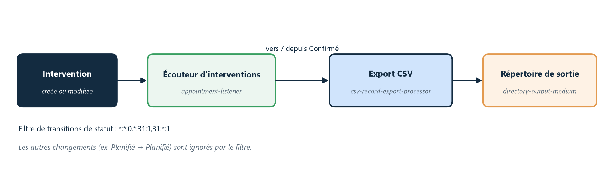

# Exporter les interventions qui passent au statut Confirmé

À chaque fois qu'une intervention devient Confirmé ou quitte ce statut, Nomadia Field Service écrit un fichier CSV dans un répertoire lu par l'ERP du client.



## Configuration

```xml
<?xml version="1.0" encoding="UTF-8"?>
<circulation-config>
  <circulation-block>
    <description>Export CSV de chaque intervention qui passe au statut Confirmé ou qui le quitte</description>
    <listeners>
      <inside-listeners>
        <appointment-listener>
          <id>interventions-confirmees</id>
          <router>export-intervention</router>
          <status-transition-filter>*:*:0,*:31:1,31:*:1</status-transition-filter>
        </appointment-listener>
      </inside-listeners>
    </listeners>
    <routers>
      <processor-routers>
        <outside-processors>
          <csv-record-export-processor separator=";" dateFormat="dd/MM/yyyy" timeFormat="HH:mm">
            <id>export-intervention</id>
            <output-medium>export-repertoire</output-medium>
            <marshaller>pseudoMarshaller</marshaller>
            <listField>APPOINTMENTID,CUSTOMERID,TASKTYPES,ASSIGNEDRESSOURCES,DATEAPPOINTMENT,TIMEAPPOINTMENT,STATUS,ADDRESS,CITY,CODEZONE,DURATION</listField>
          </csv-record-export-processor>
        </outside-processors>
      </processor-routers>
    </routers>
    <mediums>
      <output-mediums>
        <directory-output-medium>
          <id>export-repertoire</id>
          <location>D:\ECHANGES\EXPORT</location>
          <filename-pattern>intervention-{0}.csv</filename-pattern>
        </directory-output-medium>
      </output-mediums>
    </mediums>
    <transformers>
      <marshallers>
        <by-class-appt-marshaller>
          <id>pseudoMarshaller</id>
          <classname>com.geoconcept.schedule.logic.circulation.impl.PseudoMarshaller</classname>
        </by-class-appt-marshaller>
      </marshallers>
    </transformers>
  </circulation-block>
</circulation-config>
```

## Lecture de l'exemple

* Le filtre `*:*:0,*:31:1,31:*:1` refuse d'abord tous les changements, puis autorise ceux qui mènent au statut 31 (Confirmé) et ceux qui en partent (voir [Filtre de transitions de statut](../reference/ecouteurs.md)).
* `listField` liste les champs du modèle d'échange exportés, dans l'ordre des colonnes du fichier.
* Le nom du fichier est construit avec la date et l'heure de création (`{0}`), voir [Médiums de sortie](../reference/mediums.md).

## Résultat

Confirmer une intervention dans le planning produit un fichier `intervention-<date>.csv` dans `D:\ECHANGES\EXPORT`. Déplacer une intervention qui reste Planifié ne produit aucun fichier.
