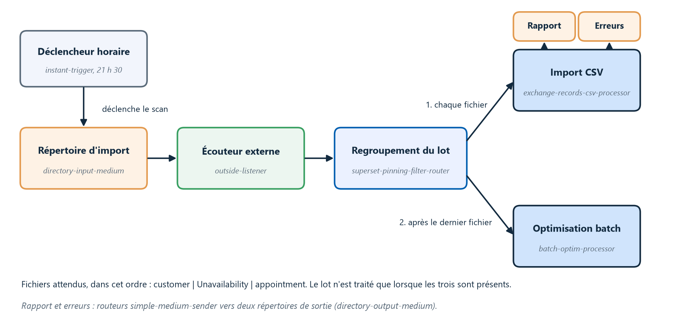

# Importer chaque soir les données du SI client, puis optimiser

Le système d'information du client dépose chaque jour trois fichiers CSV : les clients, les indisponibilités des techniciens et les interventions. À 21 h 30, Nomadia Field Service les importe dans cet ordre, produit un rapport, puis lance l'optimisation batch nommée `MyOptim` sur les données à jour.

## Avant de commencer

* Les fichiers respectent le format décrit dans `Administration > Fichiers CSV > Modèle d'import/export CSV`.
* Le nom de chaque fichier contient respectivement `customer`, `Unavailability` et `appointment`.
* Une optimisation nommée `MyOptim` existe dans Nomadia Field Service.



## Configuration

```xml
<?xml version="1.0" encoding="UTF-8"?>
<circulation-config>
  <circulation-block>
    <description>Import nocturne des clients, indisponibilités et interventions, puis optimisation</description>
    <listeners>
      <outside-listeners>
        <outside-listener>
          <id>import-csv-ecouteur</id>
          <input-medium>import-csv-repertoire</input-medium>
          <router>import-csv-lot</router>
        </outside-listener>
      </outside-listeners>
    </listeners>
    <routers>
      <filter-routers>
        <superset-pinning-filter-router>
          <id>import-csv-lot</id>
          <router>import-csv-traitement</router>
          <nextRouter>optimisation-nuit</nextRouter>
        </superset-pinning-filter-router>
      </filter-routers>
      <processor-routers>
        <inside-processors>
          <exchange-records-csv-processor separator=";" textDelimiter='"' valueListSeparator="," dateFormat="dd/MM/yyyy">
            <id>import-csv-traitement</id>
            <alert-application-log-enabled>true</alert-application-log-enabled>
            <geocoding-tolerance-type>7</geocoding-tolerance-type>
            <geocoding-min-score>0.85</geocoding-min-score>
            <ungeocoded-default-worksite>1</ungeocoded-default-worksite>
            <report-router>import-csv-rapport</report-router>
            <error-router>import-csv-erreurs</error-router>
          </exchange-records-csv-processor>
          <batch-optim-processor>
            <id>optimisation-nuit</id>
            <optim-name>MyOptim</optim-name>
          </batch-optim-processor>
        </inside-processors>
        <outside-processors>
          <simple-medium-sender>
            <id>import-csv-rapport</id>
            <output-medium>import-csv-sortie-rapport</output-medium>
            <marshaller>pseudoMarshaller</marshaller>
          </simple-medium-sender>
          <simple-medium-sender>
            <id>import-csv-erreurs</id>
            <output-medium>import-csv-sortie-erreurs</output-medium>
            <marshaller>pseudoMarshaller</marshaller>
          </simple-medium-sender>
        </outside-processors>
      </processor-routers>
    </routers>
    <mediums>
      <input-mediums>
        <directory-input-medium>
          <id>import-csv-repertoire</id>
          <location>D:\ECHANGES\A_IMPORTER</location>
          <message-selector>filesList</message-selector>
          <delete-on-success>true</delete-on-success>
          <failure-trash-location>D:\ECHANGES\REJETS</failure-trash-location>
          <trigger-files-list>customer|Unavailability|appointment</trigger-files-list>
          <instant-trigger>declencheur-21h30</instant-trigger>
        </directory-input-medium>
      </input-mediums>
      <output-mediums>
        <directory-output-medium>
          <id>import-csv-sortie-rapport</id>
          <location>D:\ECHANGES\JOURNAUX\SUCCES</location>
          <filename-pattern>rapport-{0}-{3}-{6}.csv</filename-pattern>
        </directory-output-medium>
        <directory-output-medium>
          <id>import-csv-sortie-erreurs</id>
          <location>D:\ECHANGES\JOURNAUX\ERREURS</location>
          <filename-pattern>erreurs-{0}-{3}-{6}.csv</filename-pattern>
        </directory-output-medium>
      </output-mediums>
    </mediums>
    <transformers>
      <marshallers>
        <by-class-appt-marshaller>
          <id>pseudoMarshaller</id>
          <classname>com.geoconcept.schedule.logic.circulation.impl.PseudoMarshaller</classname>
        </by-class-appt-marshaller>
      </marshallers>
    </transformers>
    <triggers>
      <instant-trigger cron-periodicity="0 30 21 ? * *">
        <id>declencheur-21h30</id>
      </instant-trigger>
    </triggers>
  </circulation-block>
</circulation-config>
```

## Lecture de l'exemple

* Le déclencheur `declencheur-21h30` (expression cron `0 30 21 ? * *`) lance le scan du répertoire chaque soir à 21 h 30.
* En mode `filesList`, le lot n'est traité que lorsque les trois fichiers attendus (`trigger-files-list`) sont présents ; ils sont transmis dans l'ordre de la liste.
* Le routeur `superset-pinning-filter-router` transmet chaque fichier à l'import, puis, après le dernier fichier du lot, appelle l'optimisation (`nextRouter`).
* L'import géocode les adresses (score minimal 0,85) ; les rapports et erreurs sont écrits dans deux répertoires distincts.
* Les fichiers traités avec succès sont supprimés (`delete-on-success`) ; les fichiers en échec sont déplacés dans `D:\ECHANGES\REJETS`.

## Résultat

Chaque soir, les clients, indisponibilités et interventions sont créés ou mis à jour, un rapport est disponible dans `D:\ECHANGES\JOURNAUX\SUCCES`, et l'optimisation `MyOptim` est lancée à la fin de l'import.
