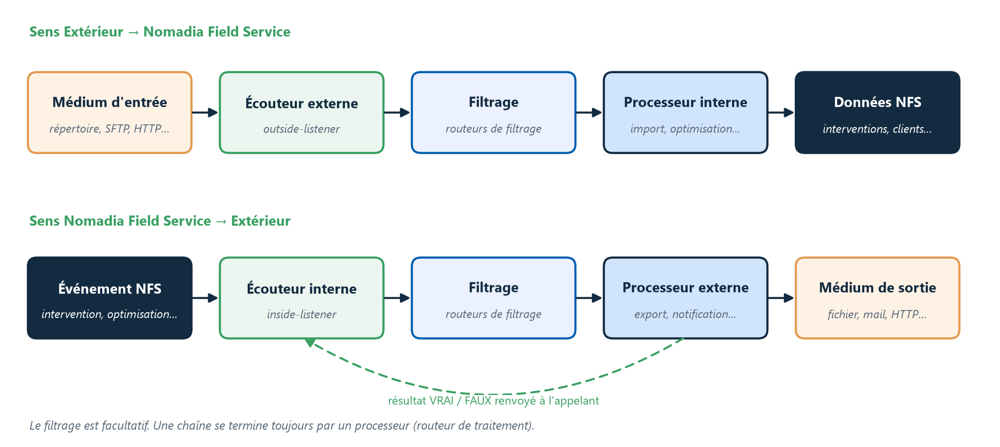
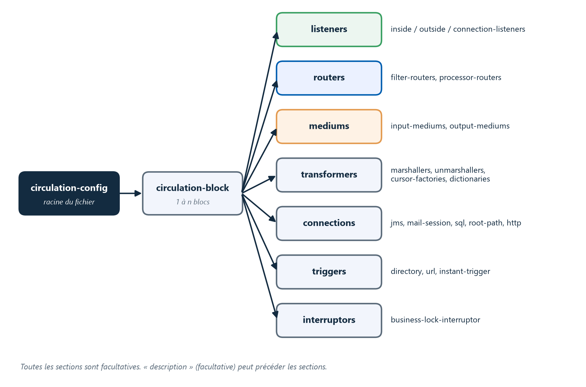

# Comprendre le fonctionnement de la circulation

## Notions clés

| Notion                             | Rôle                                                                                                                                                                                            | Section du fichier              |
| ---------------------------------- | ----------------------------------------------------------------------------------------------------------------------------------------------------------------------------------------------- | ------------------------------- |
| Écouteur (listener)                | Point de départ d'une chaîne. Interne : réagit à un événement de Nomadia Field Service (intervention modifiée, fin d'optimisation…). Externe : réagit à un message reçu sur un médium d'entrée. | `listeners`                     |
| Routeur de filtrage                | Filtre, aiguille ou complète le message, puis le transmet à un autre routeur.                                                                                                                   | `routers` / `filter-routers`    |
| Processeur (routeur de traitement) | Termine la chaîne. Interne : agit dans Nomadia Field Service (import, optimisation…). Externe : produit une sortie (fichier, e-mail, appel web…).                                               | `routers` / `processor-routers` |
| Médium                             | Canal d'entrée ou de sortie : répertoire, SFTP/FTP, HTTP, JMS, boîte mail…                                                                                                                      | `mediums`                       |
| Transformateur                     | Convertit les données en texte (ou l'inverse), découpe un message, traduit des noms de champs.                                                                                                  | `transformers`                  |
| Connexion                          | Paramètres partagés : JMS, serveur de messagerie, base SQL, chemin racine, connexion HTTP.                                                                                                      | `connections`                   |
| Déclencheur                        | Programme un scan de répertoire ou un traitement périodique.                                                                                                                                    | `triggers`                      |
| Interrupteur                       | Suspend un écouteur pendant le verrouillage d'une région.                                                                                                                                       | `interruptors`                  |
| Coffre-fort                        | Stocke, chiffrés, les identifiants et points d'accès référencés par le fichier.                                                                                                                 | écran **Coffre-fort**           |

## Chaîne de traitement

Toute la circulation fonctionne selon le même principe : un écouteur capte un événement ou un message et le transmet à un routeur. Ce routeur le transmet éventuellement à d'autres routeurs, jusqu'à un processeur qui réalise le traitement final.

## Résultat de traitement

Chaque objet indique à son appelant si le message a été correctement traité (VRAI) ou non (FAUX). Ce résultat remonte la chaîne en sens inverse et permet à l'appelant d'agir. Par exemple, un médium d'entrée de type répertoire conserve le fichier et retente son traitement, puis le déplace dans un répertoire de rejet après le nombre de tentatives prévu (voir [Médiums d'entrée](reference/mediums.md)).

Certains routeurs complètent ce résultat avec des données supplémentaires (rapport d'import, fichier généré…), exploitables par un routeur de résultat ou de rapport.

## Blocs, identifiants et références

* Le fichier contient un ou plusieurs blocs (`circulation-block`). Le découpage est libre : il sert à regrouper les objets d'un même flux.
* Chaque objet porte un identifiant (`id`) unique dans tout le fichier. Les objets se référencent entre eux par cet identifiant.
* Les blocs sont chargés dans l'ordre du fichier : un objet peut référencer les objets de son bloc ou des blocs précédents, jamais ceux des blocs suivants.
* Si une référence ne correspond à aucun objet, la circulation ne démarre pas et le rapport de chargement affiche « Impossible de trouver l'objet de circulation '…' ».


Toutes les sections d'un bloc sont facultatives. Un bloc peut contenir une description libre, affichée dans les vues de la configuration.

