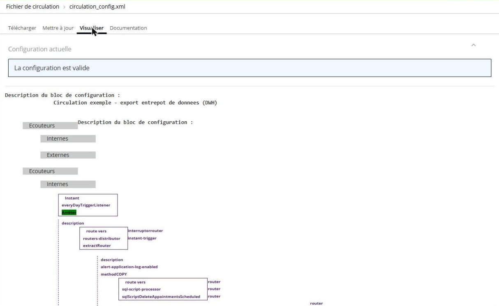
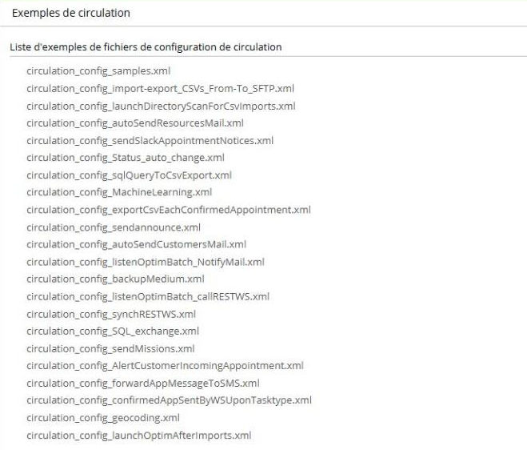
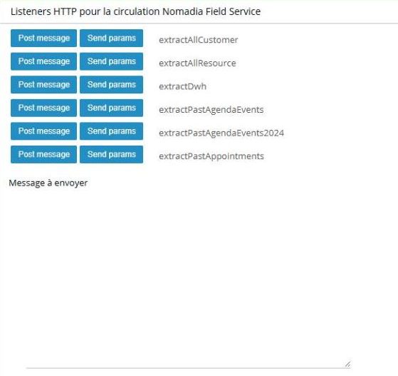

# Suivre et piloter la circulation

## Consulter la configuration en cours et piloter les écouteurs

**Navigation :** `Administration > Fichiers XML > Fichier de circulation`, onglet **Visualiser**

La vue **Configuration actuelle** présente la circulation chargée sous une forme lisible. Pour chaque écouteur, les boutons **Démarrer** et **Arrêter** permettent de le suspendre ou de le relancer sans recharger tout le fichier, par exemple pour bloquer temporairement un import.

Le bouton **Télécharger circulation\_config.xml** permet de récupérer le fichier en service.


Un écouteur arrêté ne traite plus aucun message jusqu'à son redémarrage. Notez les arrêts réalisés pour ne pas oublier de les relancer.


## Utiliser les exemples de circulation

**Navigation :** `Administration > Fichiers XML > Exemples de circulation`

L'écran liste les fichiers d'exemple livrés avec l'application (import CSV, export SQL, notifications, appels de services web…). Chaque exemple peut être affiché ou téléchargé pour servir de point de départ.


Certains exemples livrés ne respectent plus le schéma actuel. Validez toujours un exemple contre le schéma avant de l'adapter (voir [Règles générales](reference/)).


## Tester les listeners HTTP de la circulation

**Navigation :** `Administration > Fichiers CSV > Listeners de la circulation`

L'écran liste les URL HTTP actuellement écoutées par la circulation (médiums `http-input-medium`). Il permet aussi de leur envoyer un message de test, saisi dans **Message à envoyer** (boutons **Post message** et **Send params**).

Pour publier une URL de ce type, consultez [Recevoir des messages par HTTP](exemples/recevoir-messages-http.md).

## Utiliser les liens d'exportation prédéfinis

**Navigation :** `Administration > Fichiers CSV > Liens d'exportation prédéfinis`

L'écran propose des liens qui appellent des URL de la circulation, par exemple « Exporter les interventions des quatre prochaines semaines pour toutes les régions ». Un lien ne fonctionne que si la circulation déclare l'URL correspondante.
